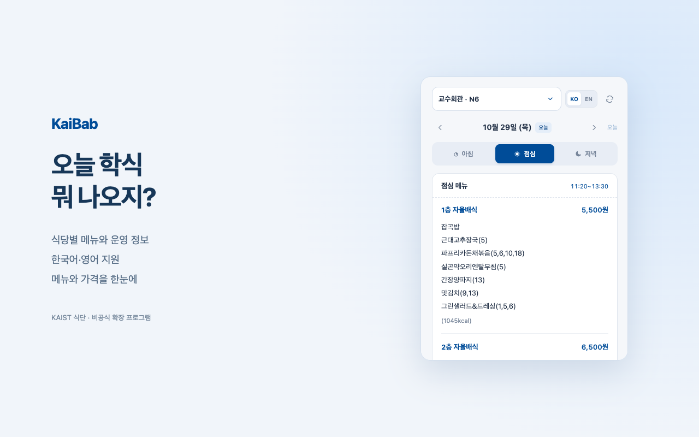

# KaiBab

**식당별 메뉴와 가격을 확인하는 KAIST 식단 확장 프로그램입니다.**

Check menus and prices at KAIST cafeterias in Korean or English, right from Chrome.

[홈페이지](https://legojeon.github.io/kaibab/) · [개인정보처리방침](https://legojeon.github.io/kaibab/privacy.html) · [문의 및 버그 제보](https://github.com/legojeon/kaibab/issues)



## 주요 기능

- **식당 12곳 선택** — 날짜별 식단 또는 고정 메뉴·운영 안내를 확인합니다.
- **날짜와 식사 선택** — 아침·점심·저녁 메뉴를 조회합니다.
- **한국어 / English** — `KO` / `EN` 버튼으로 화면과 식단 언어를 함께 바꿉니다.
- **간결한 팝업** — 메뉴 코너 옆에 가격을 표시합니다.
- **선택 기억** — 마지막으로 선택한 식당과 언어를 이 브라우저에 저장합니다.
- **최근 식단 캐시** — 연결 실패 시 저장된 메뉴를 표시하고 안내합니다.

KAIST의 공개 식단 페이지를 이용하는 **비공식 확장 프로그램**입니다. KAIST와 제휴하거나 학교의 제작·보증을 받은 앱이 아닙니다. 메뉴·시간·가격은 원본 사이트와 식당 사정에 따라 달라질 수 있습니다.

## 설치

현재 Chrome 웹 스토어에 제출하기 전 단계이며, 아래 방법으로 직접 설치할 수 있습니다.

1. 이 저장소의 **Code → Download ZIP**을 눌러 다운로드하고 압축을 풉니다. 또는 저장소를 복제합니다.
2. Chrome 주소창에서 `chrome://extensions`를 엽니다.
3. 오른쪽 위 **개발자 모드(Developer mode)**를 켭니다.
4. **압축해제된 확장 프로그램을 로드합니다(Load unpacked)**를 누릅니다.
5. 다운로드한 프로젝트 안의 **`extension` 폴더**를 선택합니다.
6. 도구 모음에 KaiBab을 고정한 뒤 아이콘을 누릅니다.

설치된 폴더를 옮겼다면 새 위치의 `extension` 폴더를 다시 불러와야 합니다.

### Install in English

Download and extract this repository, open `chrome://extensions`, enable **Developer mode**, choose **Load unpacked**, and select the **`extension`** directory. Pin KaiBab to the toolbar, then use **KO / EN** to switch languages.

## 개인정보와 권한

식당·언어 설정과 공개 식단 캐시는 Chrome 로컬 저장소에 보관합니다. 개발자 수집 서버, 광고, 분석 도구, 로그인은 없습니다.

| 권한 | 용도 |
| --- | --- |
| `storage` | 선택한 식당·언어와 최근 식단 캐시 저장 |
| `https://www.kaist.ac.kr/*` | 공식 한국어·영어 식단 페이지 조회 |

식단 요청은 KAIST로 직접 전송되므로 KAIST에는 IP 주소 등 일반 접속 정보와 요청한 식당·날짜·언어가 전달됩니다. 쿠키 등 인증 정보와 참조 페이지 URL은 요청에 포함하지 않습니다. 원격 JavaScript를 실행하지 않으며, 내려받은 HTML에서 텍스트를 추출해 표시합니다.

자세한 보관·삭제·지원 안내는 [개인정보처리방침 / Privacy policy](https://legojeon.github.io/kaibab/privacy.html)을 확인하세요.

## 개발

Node.js와 Python 3가 필요합니다.

```sh
npm ci
npx playwright install chromium --no-shell
npm test
npm run test:live
```

- `npm test`: 권한, 외부 요청 제한, 안전한 렌더링, 캐시 검증 등 보안 테스트
- `npm run test:live`: 공식 사이트에서 한국어·영어 식당 조회 및 팝업 동작 확인
- `npm run assets`: 실제 식단을 이용한 스토어 이미지 생성
- `npm run package`: Chrome 웹 스토어 업로드용 ZIP 생성

실제 사이트를 사용하는 테스트와 이미지 생성에는 네트워크 연결이 필요합니다. Playwright는 개발용 의존성이며, 설치되는 확장 프로그램에는 포함되지 않습니다. API 키나 별도 서버는 필요하지 않습니다.

### 폴더 구성

| 경로 | 내용 |
| --- | --- |
| [`extension/`](extension/) | Chrome에 불러올 확장 프로그램 |
| [`docs/`](docs/) | 설치 안내, 홈페이지, 한영 개인정보처리방침 |
| [`store/`](store/) | 스토어 소개문, 제출 체크리스트, 검토 보고서와 이미지 |
| [`tests/`](tests/) | 보안 및 실제 브라우저 테스트 |
| [`scripts/`](scripts/) | 이미지·배포 ZIP 생성 도구 |
| `dist/` | 생성된 업로드 ZIP — Git에는 포함하지 않음 |

## Chrome 웹 스토어 제출

[제출 체크리스트](store/SUBMISSION-CHECKLIST.txt)와 [스토어 소개문·권한 설명](store/LISTING.txt)을 먼저 확인하세요.

```sh
npm run package
```

생성되는 `dist/kaibab-1.2.0-chrome-web-store.zip`을 업로드합니다. 이 ZIP은 `manifest.json`이 최상위에 있고 확장 프로그램 실행 파일만 포함합니다. **저장소 전체를 다운로드한 ZIP은 스토어 업로드용이 아닙니다.**

[보안·출시 검토 보고서](store/SECURITY-REVIEW.html)에는 검토 범위와 확인 결과, 제출 전 남은 항목이 정리되어 있습니다.

## 라이선스와 출처

별도의 오픈소스 라이선스는 아직 지정하지 않았습니다. 공개 저장소라는 사실만으로 MIT·Apache 등의 라이선스가 부여되지는 않습니다.

식단 콘텐츠의 출처는 [KAIST 공식 식단 페이지](https://www.kaist.ac.kr/kr/html/campus/053001.html?dvs_cd=emp)입니다. 공식 KAIST 로고는 사용하지 않습니다.
