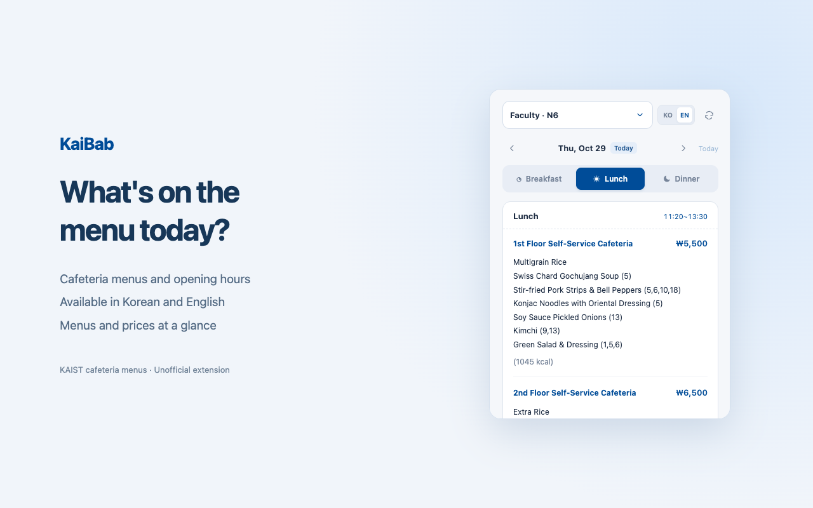

# KaiBab

English · [한국어](README.ko.md)

A Chrome extension for KAIST cafeteria menus and prices.

[Website](https://legojeon.github.io/kaibab/) · [Privacy](https://legojeon.github.io/kaibab/privacy.html) · [Support](https://github.com/legojeon/kaibab/issues)

## Features

- 12 cafeteria options from the KAIST website
- Daily menus where available; dining guides for the other options
- Korean and English menus from the corresponding KAIST pages
- Prices where listed in the source
- Saved cafeteria and language preferences
- Previously loaded menus available without a connection while a matching saved copy remains; saved information may be out of date

## Install

To install manually:

1. Select Code → Download ZIP and extract the archive.
2. Open chrome://extensions in Chrome.
3. Turn on Developer mode.
4. Select Load unpacked, then choose the extension folder inside the downloaded project.
5. Pin KaiBab to the toolbar and click its icon.

If you move the folder, load it again from the new location.

## Privacy

The extension saves your cafeteria and language preferences and recent menus in local Chrome storage. No ads, analytics or developer collection server.

To fetch a menu, it sends the selected cafeteria, date and language to KAIST. KAIST also receives connection information such as your IP address. Details in the [privacy policy](https://legojeon.github.io/kaibab/privacy.html).

## Source

[KAIST cafeteria website](https://www.kaist.ac.kr/en/html/campus/053001.html?dvs_cd=emp)

KaiBab is independently developed and is not affiliated with or endorsed by KAIST. Menus, hours and prices subject to change.
